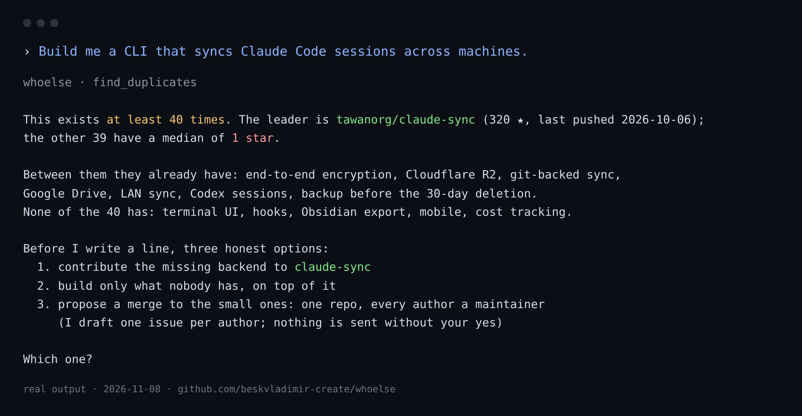

# whoelse

<!-- mcp-name: io.github.beskvladimir-create/whoelse -->

**Don't build it alone.**

Ask an agent to build something and it will, for the 21st time. Somewhere, twenty people already
built it, each got ten stars, and three more are working on the same thing right now. None of them
know each other.

whoelse puts one call in front of the first line of code: what already exists, who won, what nobody
has, and then the step no other tool takes: a plan to merge the small ones into one project with
every author on it, or the person whose current work overlaps yours, with what the two of you could
build and the first message drafted. Nothing is sent without you.

Runs inside Claude, Cursor, Codex or any MCP client. No sign-up, no profile to fill in, no server. Free.

```bash
pip install git+https://github.com/beskvladimir-create/whoelse
```



---

## The problem

Nobody is working alone on purpose. It just turns out that way: you publish, nothing happens, you go back to work. The person who would have cited you, tried your code, co-written the next paper with you, is two time zones away and has never heard your name. Discovery runs on conferences and luck, and most people get neither.

whoelse replaces luck with a lookup, and then does something with what it finds.

## Don't build it alone

Idea checkers exist ([idea-reality-mcp](https://github.com/mnemox-ai/idea-reality-mcp) scores an
idea against GitHub, HN and npm and stops at "here are similar projects"). whoelse starts where they
stop. Ask your agent to build a tool:

> Build me a CLI that syncs Claude Code sessions across machines.

```
"a CLI that syncs Claude Code sessions across machines" exists at least 40 times. The leader is
tawanorg/claude-sync (320 stars, last pushed 2026-10-06); the other 39 have a median of 1.
Between them: end-to-end encryption, Cloudflare R2, git-backed sync, Google Drive, LAN sync,
Codex sessions, backup before the 30-day deletion. None of the 40 has a terminal UI, hooks,
an Obsidian export, mobile, or cost tracking.

Options: contribute the missing backend to claude-sync; build only what nobody has; or propose a
merge to the small ones (propose_merge).
```

(Real output, 2026-11-08, unauthenticated GitHub search.)

That is `find_duplicates`. It searches GitHub for the job the tool does (not the product it serves),
keeps what is actually the same thing, ranks it, and builds a feature matrix: who has what, what only one of them has, what none of them
has. The verdict comes first, in one sentence. Hundreds of hours of rebuilding the same thing, and
the tokens spent on it, stop here.

`propose_merge` goes one step further. For a cluster of small duplicates it writes the merge plan
(the living leader as the base; what each repository brings, from its own README; every author a
maintainer with write access; nothing deleted; a release date) and the text of one issue for each
author, in their own repository, where they already read. The issues go out only after you have
read them and said yes, from your GitHub account, all at once, so no author is asked to join
someone else's project: all of them are asked to join one.

GitHub's acceptable use forbids bulk unsolicited content, and so does common sense, so the limits
are in the code: 3 to 15 living repositories per proposal, at most 10 issues a day, 3 seconds
apart, never twice to the same repository (a local ledger remembers), never to an archived, forked, inactive or
organisation-owned repository, one with issues turned off, one with 1000+ stars, or your own. One proposal is a conversation; forty is a mailing.

### Put it in front of the agent

`plugin/` is a Claude Code plugin (MCP server plus a `dont-build-it-alone` skill) that makes the agent
call `find_duplicates` before it starts building anything the user describes. For Cursor, Codex and
other MCP clients the same skill text goes into the rules file. The user sees what exists before the
first line is generated, which is the only moment the information is worth anything.

Real runs, one page per idea, are in [docs/clusters](docs/clusters/README.md): session sync for
Claude Code, arXiv MCP servers, PII anonymization for LLMs, token-cost dashboards, Obsidian site
generators, DICOM in Rust.

## How it connects strangers

Finding people is the easy half. whoelse is built around the hard half: two people who have never
heard of each other end up working on one thing, fast.

**1. The work starts before the first message.** `start_joint_work` builds a repository with the
paper outline, section 1 drafted from both sides' published abstracts, a comparison table holding
the numbers each side already published, a reproduction script pointing at both codebases, both
names on the byline, and a 14-day plan. The other person receives a link to a third of a finished
work. Saying yes is opening an issue titled "in". Saying no is ignoring it: after 14 days you
finish alone and cite them.

**2. Mutual matching without any letters.** `publish_request` puts what you want to build into an
open registry (one JSON file per person, in a public GitHub repository; no account with us, no
server). It publishes your name and email, so your agent shows you the file and asks before it
goes. Anyone who installs whoelse with the same problem is matched to you. When both sides want the
same format on the same problem, one watcher (the side whose name sorts first) creates the
repository, invites the other, and emails both; the other watcher sees the repository appear and
confirms, or takes over after three days of silence.

**3. Nobody falls out of the queue.** If there is no match today, whoelse says so plainly:

> Your request is published. 37 people are waiting in the network, none on text-to-SQL yet. When
> one joins, the work starts by itself and a link goes to you@example.org. Nothing to do; just
> don't remove whoelse.

`whoelse-watch --loop 6h` keeps checking. The link arrives by email (your own SMTP, or GitHub's own
notification when the repository is created and you are invited).

**4. Strangers, by design.** People you already publish with are listed separately and never
proposed. Requests that share an id with yours are skipped. Complementary assets score higher:
your code against their data, their paper against your system.

**5. Nobody's name goes public on the strength of a file.** A registry file is data written by a
stranger. It must fit a strict schema; the registry's CI merges it only if `ids.github` is the
login that opened the pull request and the file is not someone else's; the watcher acts on it only
if that GitHub profile's display name is the name in the file. That proves the file belongs to that
account, not that the account is the researcher it names, so the joint repository is created
**private**, the account is invited, and it goes public only after they accept and say "in". If
they never do, you finish alone and publish without their name, citing their work. A repository
that already exists is never overwritten.

## What you get

Ask your agent:

> Load my profile: Vladimir Beskorovainyi, ORCID 0009-0004-7005-6242. Who else is working on this?

```
25 people are working on what Vladimir Beskorovainyi is working on (personal papers; archives; text classification).
4 can be written to today.

 0. Angelo La Gorga (Universidad Carlos III de Madrid): same problem: personal papers; active 2026-09.           reach: email
 1. Fabian Karl (Universität Ulm): same topic: computational and text analysis, text classification; active 2026-01. reach: email
 2. Lukas Galke (University of Southern Denmark): same topic: text classification; active 2026-01.                reach: email
```

> Start a comparison note with Ada Example (illustration; the names below are made up).

```
Repository: github.com/you/you-example-text-to-sql
  paper/paper.md     outline; section 1 drafted from both abstracts; table with published numbers
  repro/run.py       both methods, same data, same metric; each side fills its half
  PLAN.md            14 days to a preprint
  CITATION.cff       both names
Send this: three sentences, the link, one yes/no question. To: ada@example.org (from her whoelse card)
```

> Publish my request: a comparison note on text-to-SQL for closed enterprise data, by December.

```
Your request is published. 2 people are waiting in the network; 1 wants what you want: Ana Example
(illustration), text-to-sql, has a dataset you don't. Joint work can start now.
```

## How it finds people

Three directions at once, then merged into people:

| direction | source | what it catches |
|---|---|---|
| papers | OpenAlex keywords and topics; arXiv for preprints OpenAlex hasn't indexed yet | who published on your exact problem in the last 24 months |
| code | GitHub repository search | who is building it |
| models and data | Hugging Face Hub | who released weights or a dataset (quantisations and repacks are filtered out) |

A GitHub login, a Hugging Face account and an OpenAlex author become one person only when a second signal says so: the same affiliation, a link from their paper to that account, the same website. A shared name alone keeps them apart, flagged as possible namesakes, so one person's email never lands next to another's work. Organisations (a company's GitHub, a lab's Hugging Face) are recognised and left out. Authors who link their own code in an arXiv comment are joined automatically, including you: give whoelse your name and it usually finds your handles itself.

If several people share your name, whoelse does not guess. It shows you the namesakes and asks for an ORCID or an affiliation.

A third reach channel, GitHub user search by full name, is used only when it returns exactly one account whose repositories are about the same subject; otherwise it is ignored. On real data it finds roughly one in three researchers who left nothing on ORCID.

## How it reaches them

Only through what the person published about themselves, and every contact says where it came from:

- ORCID: public email, personal site, GitHub, Scholar, LinkedIn (limited-visibility emails are never read)
- GitHub profile: public email, website
- Their own website: a whoelse card, if they have one

arXiv submitter emails are never touched. arXiv's terms forbid using them for unsolicited contact, and we don't need them.

## The network

A public GitHub repository, `beskvladimir-create/whoelse-network`, with one JSON file per person
under `people/`. Your agent opens the pull request (with a `GITHUB_TOKEN` that has `public_repo`
scope), or writes the file and tells you where to put it. Calling `publish_request` again renews
or updates your file on the same branch. Requests expire after three months. Reading needs no
account. There is no server and nothing to sign up for; the repository is the directory. The
registry's own CI and README are in `registry/` in this repository.

`whoelse-watch` reads it fresh every pass (the registry is never served from cache), matches your
request against everyone else's, and when two people want the same format on the same problem it
builds the workspace, creates the repository, invites the other side, and emails both; once per
pair, with state saved after every step. Run it from cron or launchd:

```
0 */6 * * *  whoelse-watch
```

## The card: connected mode without a server

Put this on your own site at `/.well-known/whoelse.json`:

```json
{
  "name": "Ada Example",
  "working_on": ["text-to-SQL on open-weight models", "schema linking"],
  "open_to": ["co-author", "joint benchmark", "talk together"],
  "contact": "ada@example.org",
  "languages": ["en", "pt"],
  "updated": "2026-11-07"
}
```

Anyone running whoelse now sees you as **connected**: reachable, and open to exactly what you said. When both sides have a card, both of you are one `joint_work_brief` away from the same proposal; sending it to both at once is on the roadmap. No registry, no account, no central anything. The web is the directory. `make_card` writes yours.

## Your people

Once you've decided someone is one of yours (`add_peer`), whoelse watches what they ship and tells you when there is something to support: a repo to try and star, a paper to cite or argue with, a model to run on your data and report back. It never stars, follows or likes anything for you. GitHub names automated starring and following as rank abuse, and a circle that fakes its own signal is worth nothing to the people in it.

## Tools

| tool | what |
|---|---|
| `load_profile` | your profile from OpenAlex, arXiv, GitHub, Hugging Face, ORCID |
| `find_overlaps` | people whose recent work overlaps yours, ranked, with reasons and public contacts |
| `joint_work_brief` | one person: the evidence, what each side has, formats ranked by fit and effort, venues in common |
| `draft_outreach` | facts and structure for the first message; your agent writes it, you send it |
| `add_peer`, `remove_peer`, `whats_new_from_peers` | your people and what they shipped this month |
| `find_duplicates` | before building: what exists, who won, what nobody has |
| `propose_merge` | a merge plan for a cluster of duplicates and one issue per author (sent only on your yes) |
| `publish_request` | join the network: what you want to build, with whom, by when |
| `start_joint_work` | a repository with a third of the work done and both names on it |
| `make_card` | your `/.well-known/whoelse.json` |
| `list_known` | profiles and peers on this machine |

## Install

```bash
pip install whoelse            # or: pip install git+https://github.com/beskvladimir-create/whoelse
```

Claude Code: `claude mcp add whoelse -- whoelse`

Claude Desktop, Cursor, Codex and others, in the MCP config:

```json
{ "mcpServers": { "whoelse": { "command": "whoelse" } } }
```

Optional environment:

| variable | effect |
|---|---|
| `WHOELSE_OPENALEX_KEY` | free key from openalex.org/settings/api; without it you share a small per-IP daily budget |
| `WHOELSE_MAILTO` | your email for OpenAlex's polite pool; sent nowhere else |
| `GITHUB_TOKEN` | raises GitHub search limits (any scope); `public_repo` scope is needed for `publish_request`, `start_joint_work` and the watcher |
| `WHOELSE_SMTP_HOST`, `_PORT`, `_USER`, `_PASS`, `_FROM` | the watcher's email, sent from your own address; without them, notifications land in `~/.whoelse/inbox/` |
| `WHOELSE_HOME` | where profiles, peers and cache live (default `~/.whoelse`) |

## What it will not do

- Send a letter for you. Drafts are yours to send, from your own address, one person at a time.
  The only automatic messages are the watcher's: to you, and to a verified stranger, once, with a
  public repository link, after you joined the network and confirmed what gets published.
- Use a contact the person did not publish themselves (their ORCID, their GitHub, their own card,
  their own registry file).
- Star, follow, like or post on your behalf.
- Keep anything about you anywhere but your machine, except the registry file you confirmed and
  the joint repositories you asked for.

## First run on your own name

```bash
WHOELSE_MAILTO=you@example.org python -m whoelse.scripts.first_run "Your Name" --orcid 0000-0000-0000-0000
```

Prints the people, the reasons, the best format for each, and how to reach them; saves everything to `whoelse-first-run.json`. Nothing is sent.

## Develop

```bash
git clone https://github.com/beskvladimir-create/whoelse && cd whoelse
pip install -e ".[dev]"
pytest                                                      # offline, on recorded fixtures
WHOELSE_FIXTURES=tests/fixtures python -m whoelse.server    # offline demo server
```

Sources: [OpenAlex](https://openalex.org) (CC0), [arXiv](https://arxiv.org) (CC0 metadata), [ORCID](https://orcid.org) public API, [GitHub](https://docs.github.com/en/rest), [Hugging Face Hub](https://huggingface.co/docs/hub/api). All keyless.

MIT.
